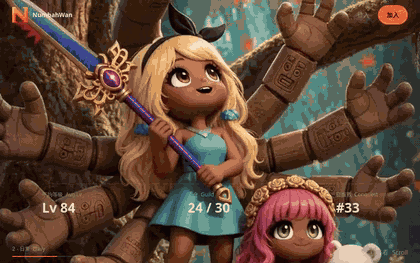
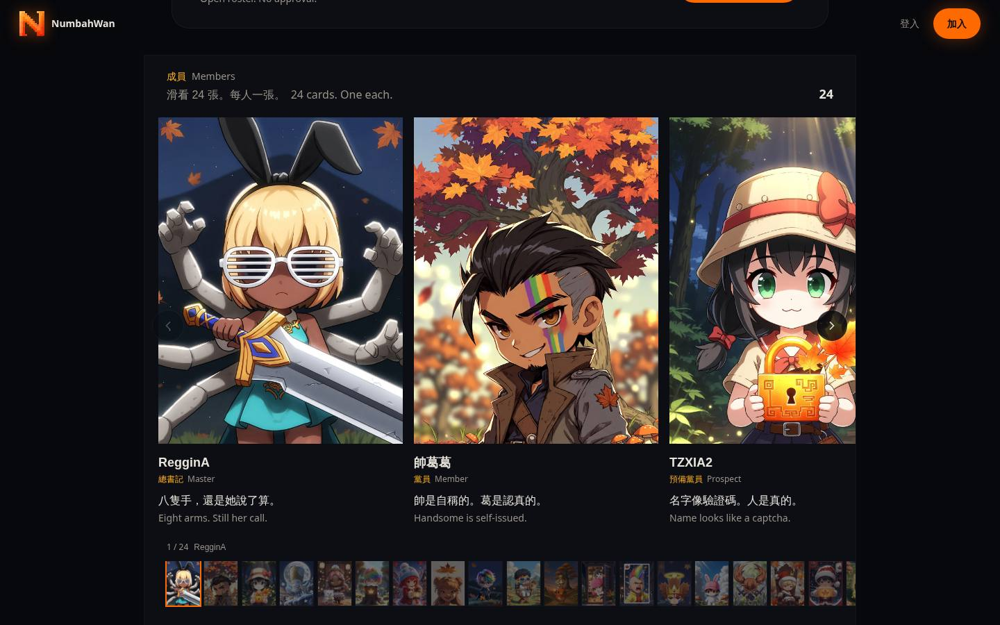
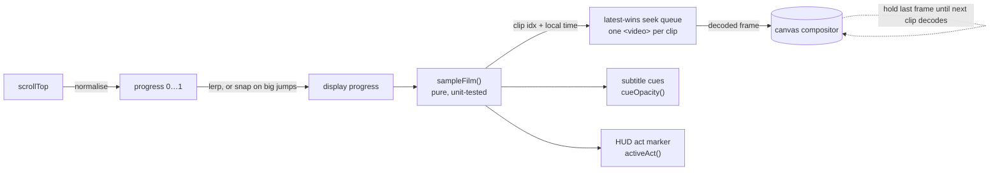

<div align="center">


# NumbahWan

**A scroll-driven film you control with your scrollbar, built as the home page for a MapleStory Idle guild.**

Eight all-intra H.264 clips are scrubbed frame by frame from scroll position and painted onto a canvas. Scrolling forwards or backwards is smooth, and it works on iOS Safari without calling `play()` once.

[](https://github.com/9tvf4k6srt-sys/NumbahWan/actions/workflows/ci.yml)


[](LICENSE)



</div>

---

## Highlights

| | |
|---|---|
| 🎞️ **Frame-accurate scroll scrubbing** | Scroll position maps to `HTMLVideoElement.currentTime` across 8 clips (~52 s of footage). Every clip is encoded GOP=1 (all keyframes, no B-frames), so any seek lands on a real frame. |
| 📱 **Works on iOS Safari** | The film never calls `play()`, so autoplay rules don't apply. Each clip is prefetched as a `Blob` URL, which makes fast and reverse seeks local I/O. |
| 🖼️ **No black flashes** | A canvas compositor keeps the last good frame while the next clip decodes, uses a "latest-wins" seek queue, and pre-seeks neighbouring clips. |
| ♿ **Accessible by default** | `prefers-reduced-motion` swaps the film for static scenes. The join dialog is a real modal (`aria-modal`, focus management, Escape to close). All copy is bilingual and tagged with `lang`. |
| 🗄️ **Postgres with no setup** | Uses Neon/Postgres in production. With no `DATABASE_URL`, an embedded **PGLite** (Postgres compiled to WASM) runs the same migrations, so `npm run dev` works on a fresh clone. |
| 🔐 **Validated server functions** | Type-safe TanStack Start server functions, a pure and unit-tested input validator shared by client and server, and parameterised SQL only. |
| ✅ **CI on every push** | Strict typecheck, lint, format check, unit tests with coverage, and a production build, then a real-browser E2E run against the built server. |

## Screenshots

<table>
<tr>
<td width="68%"></td>
<td rowspan="2"></td>
</tr>
<tr>
<td></td>
</tr>
<tr>
<td colspan="2"></td>
</tr>
</table>

## How the scroll scrub works



1. **Timeline model** (`src/lib/film.ts`): each clip has a *weight*, and the weights are normalised into contiguous windows that cover `[0, 1]` exactly. `sampleFilm(p)` returns the active clip, the next clip, local progress and seek time. It's pure, and tests check that it is monotonic, never skips a clip, and never seeks past the last decodable frame.
2. **Input smoothing** (`film-experience.tsx`): a single `requestAnimationFrame` loop eases displayed progress toward the scroll target. Jumps larger than 4 % *snap* instead, so a fast fling doesn't make the decoder walk through every clip in between.
3. **Decoder pool** (`film-video.tsx`): one muted, inline `<video>` per clip, each fed from a prefetched Blob URL. When a seek is still in flight, the newest target is queued and older ones are dropped. On a clip change, the previous and next clips are pre-seeked to their boundary frames.
4. **Compositor**: frames are drawn to a DPR-aware canvas with cover-fit. The outgoing clip stays on screen until the incoming one reports `videoWidth > 0`, so you never see black. The opening shot draws the pixel-art logo on top and crash-zooms it with scroll.

The deeper design notes (trade-offs and rejected alternatives) are in **[docs/ARCHITECTURE.md](docs/ARCHITECTURE.md)**.

## Tech stack

| Layer | Choice |
|---|---|
| Framework | **React 19**, **TanStack Start** (SSR + server functions), TanStack Router (file-based, type-safe) |
| Language | **TypeScript** (`strict`), ES2022 |
| Styling | **Tailwind CSS v4**, custom design tokens |
| Rendering | Canvas 2D, `HTMLVideoElement` seek pool, `requestAnimationFrame` |
| Data | **Postgres** (Neon) in production, **PGLite** (WASM) locally; SQL migrations applied during build |
| Auth | **Better Auth** (sessions, OAuth, email/password) |
| Build / deploy | **Vite 8**, **Nitro** (Vercel preset by default, `node-server` for self-hosting) |
| Quality | Vitest + v8 coverage, Playwright E2E, ESLint 9 (flat config), Prettier, GitHub Actions |
| Media pipeline | ffmpeg (all-intra H.264 encode), Python QA scripts for frame checks |

## Getting started

Requires **Node 22+** (see `.nvmrc`). You don't need any environment variables to run it locally.

```bash
git clone https://github.com/9tvf4k6srt-sys/NumbahWan.git
cd NumbahWan
npm install
npm run dev            # http://localhost:8080
```

| Script | What it does |
|---|---|
| `npm run dev` | Vite dev server with HMR, plus embedded PGLite database |
| `npm run check` | Typecheck, lint and all tests (the same gate CI runs) |
| `npm run test:unit` | Vitest unit and content-integrity tests |
| `npm run coverage` | Unit tests with a v8 coverage report |
| `npm run build:node` && `npm start` | Production build as a standalone Node server |
| `npm run test:e2e` | Playwright smoke test against a running server |
| `npm run build` | Vercel build; applies migrations to `DATABASE_URL` if set |

Optional configuration is documented in [`.env.example`](.env.example).

## Testing strategy

| Suite | Scope | Run |
|---|---|---|
| **Unit** (`tests/film.test.ts`) | Timeline invariants: windows cover `[0,1]` exactly, sampling is monotonic and never skips a clip, seeks stay in bounds, cue fades and act boundaries are correct | `npm run test:unit` |
| **Validation** (`tests/join-schema.test.ts`) | Trimming, length clamps, CJK names, malformed and hostile payloads | `npm run test:unit` |
| **Content integrity** (`tests/content-integrity.test.ts`) | Every video, poster, still and portrait referenced in code exists on disk. Roster and stats are consistent | `npm run test:unit` |
| **Tooling** (`scripts/*.test.mjs`) | Build plugins and brand/OG asset checks | `npm run test:tools` |
| **E2E** (`e2e/smoke.mjs`) | Real Chromium against the **production build**: film decodes and paints, scrolling advances acts, modal a11y, join form writes to Postgres | `npm run test:e2e` |

Core logic (`film.ts`, `join-schema.ts`, `guild.ts`, `members.ts`) has **~98 % statement coverage**.

## Project structure

```
src/
├── routes/                 # File-based routes (TanStack Router)
│   ├── __root.tsx          # <head>, OG/PWA meta, providers
│   ├── index.tsx           # The film
│   └── api/auth/$.ts       # Better Auth handler
├── components/cinematic/   # Film, compositor, HUD, overlays, member hall, join modal
├── lib/
│   ├── film.ts             # Pure timeline model (clips → windows → samples, cues, acts)
│   ├── join-schema.ts      # Pure input validator shared by client and server
│   ├── join.ts             # Server function: persist a join request
│   ├── db.ts               # Neon ⇄ PGLite adapter, migration runner
│   └── auth/               # Better Auth server/client, session hooks, guards
migrations/                 # Ordered SQL, the single source of truth for the schema
tests/                      # Vitest suites
e2e/                        # Playwright smoke test
scripts/                    # Media pipeline (ffmpeg/Python), QA checks, build plugins
docs/                       # Architecture notes and README media
```

## Engineering notes

- **Why canvas instead of showing the `<video>` directly?** Swapping between video elements causes a visible black frame on iOS. Painting to one canvas lets the compositor choose which decoded frame is on screen, so it can hold the last good frame.
- **Why all-intra encoding?** With normal GOPs, seeking to an arbitrary time means decoding forward from the previous keyframe, which is slow and jittery in reverse. GOP=1 makes every frame independently decodable. Files get larger, so clips are prefetched once and cached.
- **Why snap on large jumps?** If the lerp is allowed to animate across a 30 % jump, the decoder has to seek through every clip in between. Snapping when the gap is over 4 % keeps the response quick.
- **Why PGLite?** Contributors and CI get a real Postgres engine with zero setup. Production switches to Neon just by setting `DATABASE_URL`, with no code changes.

## License

[MIT](LICENSE). Game names and references belong to their respective owners; this is a fan community project.
